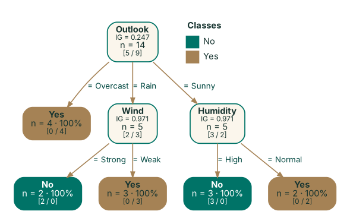
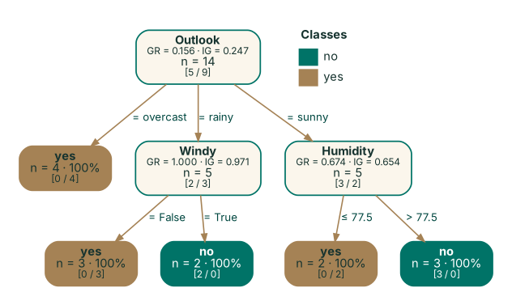
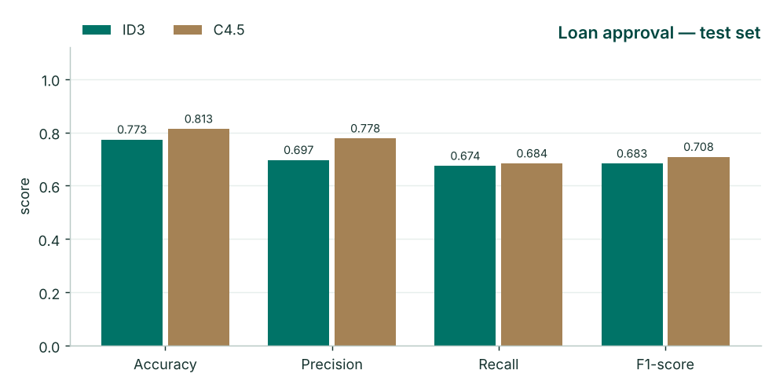

# Decision Tree Classification System

An interactive Streamlit application for building, visualising, evaluating and comparing **ID3** and **C4.5**
decision-tree classifiers on any classification dataset in CSV format. Both algorithms are implemented
from scratch in Python with NumPy and Pandas; scikit-learn is used for the train/test split, metrics and an
optional CART reference model, Matplotlib for charts, and Graphviz for drawing the trees.

The interface follows the **GITAM Brand Guidelines 2024-25** colour palette (GITAM Green `#007367`,
Antique White `#F4E4C9`, Dark Green `#004740`, Antique Gold `#A58255`, with Wide Blue / Kind Coral /
Mellow Yellow as tertiary accents) and uses Inter, GITAM's secondary typeface for digital material.

## Contributors

| Name | Registration no. |
|---|---|
| Karthik Naidu Allu | 2023002399 |
| Boddu Narayana Gupta | 2023002459 |

---

## Features

| Stage | What the system does |
|---|---|
| **Upload** | Any CSV (comma, semicolon, tab… auto-detected). `?`, `NA`, `null`, blanks are read as missing. Four sample datasets included. |
| **Target selection** | Pick the class attribute and the attributes to train on; ID-like and constant columns are excluded by default; warnings for continuous or degenerate targets. |
| **Preprocessing** | Missing values: impute (median / mode), drop rows, or C4.5-native handling. Numeric attributes discretised for ID3 (equal-frequency or equal-width bins). Stratified train/test split. All statistics learned on the training split only. |
| **ID3** | Information gain, multi-way categorical splits. |
| **C4.5** | Gain ratio (with Quinlan's average-gain rule), binary thresholds for continuous attributes, fractional-instance missing-value handling, error-based pruning with confidence factor, optional MDL penalty. |
| **Tree display** | Graphviz rendering with split scores, class counts and purity-shaded leaves; adjustable display depth and orientation; download as DOT / SVG / PNG; IF-THEN rule extraction; attribute importance. |
| **Predictions** | Test-set predictions (filter disagreements / errors, download CSV), single-instance prediction with the decision path of each model, batch prediction on a new CSV. |
| **Evaluation** | Confusion matrix (counts or row %), accuracy, precision, recall, F1 (macro / weighted / micro), per-class report. |
| **Comparison** | Side-by-side table and chart, tree size and timing, agreement rate, automatic summary, k-fold cross-validation (mean ± sd), optional scikit-learn CART baseline. |

<p align="center">
  
  
</p>
<p align="center"></p>

## Getting started

Requirements: Python 3.10+ and the Graphviz system package (provides the `dot` renderer used for SVG/PNG downloads).

```bash
# 1. clone
git clone https://github.com/<your-username>/decision-tree-classifier.git
cd decision-tree-classifier

# 2. Graphviz system binaries
#    Windows: winget install graphviz   (or https://graphviz.org/download/, add bin/ to PATH)
#    macOS:   brew install graphviz
#    Ubuntu:  sudo apt-get install graphviz

# 3. Python environment
python -m venv .venv
source .venv/bin/activate          # Windows: .venv\Scripts\activate
pip install -r requirements.txt

# 4. run
streamlit run app.py
```

The app opens at <http://localhost:8501>. The tree view itself is drawn in the browser, so it works even
without the Graphviz binaries; only the SVG/PNG download buttons need them.

### Using the app

1. **Dataset** — upload a CSV or choose a sample.
2. **Target & attributes** — choose the class column and the attributes to use.
3. **Preprocessing** — test size, seed, missing-value strategy, ID3 binning.
4. **Tree settings** — max depth, minimum samples, C4.5 pruning and confidence factor, metric averaging.
5. Results update automatically (or press **Train ID3 & C4.5**). Explore the tabs:
   *Data → Preprocessing → Decision trees → Predictions → Evaluation → Comparison → About.*

### Sample datasets (`data/`)

| File | Rows | Notes |
|---|---|---|
| `play_tennis.csv` | 14 | Mitchell's classic categorical example (ID3) |
| `weather_numeric.csv` | 14 | Quinlan's weather data with numeric temperature/humidity (C4.5) |
| `iris.csv` | 150 | Four continuous attributes, three classes |
| `loan_approval.csv` | 500 | Synthetic, mixed types with ~5 % missing values (`scripts/generate_loan_data.py`) |

## Project structure

```
decision-tree-classifier/
├── app.py                   # Streamlit user interface
├── dtree/                   # core library (no Streamlit dependency)
│   ├── base.py              # tree nodes, entropy, shared growth / prediction / rules / explain
│   ├── id3.py               # ID3: information gain
│   ├── c45.py               # C4.5: gain ratio, thresholds, missing values, pruning
│   ├── preprocessing.py     # CSV loading, profiling, imputation, discretisation, split
│   ├── metrics.py           # accuracy, precision, recall, F1, confusion matrix
│   ├── pipeline.py          # training, comparison table, k-fold cross-validation
│   ├── visualize.py         # Graphviz DOT export and rendering
│   ├── plots.py             # Matplotlib charts in the GITAM palette
│   └── theme.py             # brand colours
├── data/                    # sample datasets
├── docs/ALGORITHMS.md       # algorithm and design documentation
├── scripts/                 # data generation
├── tests/                   # pytest suite
├── .streamlit/config.toml   # Streamlit theme (GITAM palette)
└── requirements.txt
```

## Using the library without the UI

```python
import pandas as pd
from dtree import ID3Classifier, C45Classifier
from dtree.visualize import tree_to_dot

df = pd.read_csv("data/weather_numeric.csv")
X, y = df.drop(columns="Play"), df["Play"]

c45 = C45Classifier(min_samples_leaf=1, prune=False).fit(X, y)
print(c45.rules())
print(c45.explain(X.iloc[0]))
open("tree.dot", "w").write(tree_to_dot(c45))
```

## Tests

```bash
pip install pytest
python -m pytest -q
```

The suite checks the textbook results (ID3 reproduces Mitchell's Play-Tennis tree with root gain 0.2467;
C4.5 finds Quinlan's humidity threshold on the weather data), the bias of information gain toward ID
columns, missing-value handling, pruning, preprocessing leakage, metrics, cross-validation and DOT
rendering. GitHub Actions runs it on every push (`.github/workflows/tests.yml`).

## Documentation

See [`docs/ALGORITHMS.md`](docs/ALGORITHMS.md) for the formulas, implementation details, design decisions
and known limitations.

## References

- J. R. Quinlan, "Induction of decision trees", *Machine Learning* 1, 81–106, 1986.
- J. R. Quinlan, *C4.5: Programs for Machine Learning*, Morgan Kaufmann, 1993.
- J. R. Quinlan, "Improved use of continuous attributes in C4.5", *JAIR* 4, 77–90, 1996.
- T. M. Mitchell, *Machine Learning*, McGraw-Hill, 1997, ch. 3.
